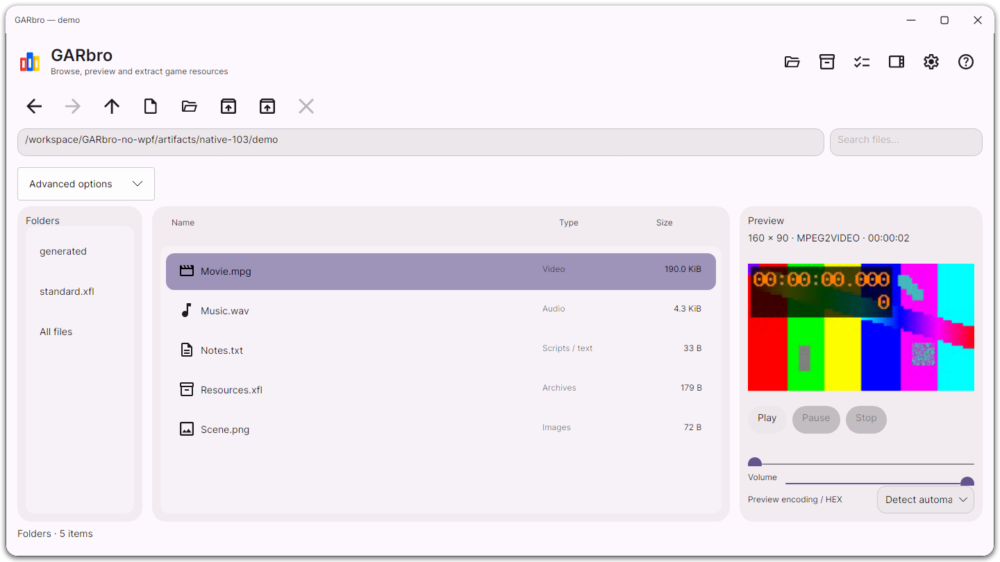

# GARbro

[简体中文](README.md) · **English** · [Русский](README.ru.md) · [日本語](README.ja.md)

Open a game's resource archives, browse pictures, play audio and video, and extract the files you need. GARbro has a desktop interface and a command-line tool.



## Download and start

Choose a package from the [release download page](https://github.com/Love-in-idleness/GARbro-no-wpf/releases/tag/v1.0.3). Use **x64** for most Intel and AMD computers, or **arm64** for Windows on ARM, ARM Linux, and Apple silicon.

| System | Package | Open it |
| --- | --- | --- |
| Windows | `win-x64.zip` or `win-arm64.zip` | Extract it and open `desktop/GARbro.Desktop.exe` |
| Windows installer | Matching `.msix` and `.cer` | Follow the [installation guide](docs/install.md) to trust the test certificate, then install the MSIX |
| Debian 13 / Ubuntu 24.04 | Matching `.deb` | Install it, then open GARbro from your application menu |
| Other Linux distributions | `linux-x64.tar.gz` or `linux-arm64.tar.gz` | Extract it and run `desktop/GARbro.Desktop` |
| macOS 14 or later | `osx-arm64.dmg` for Apple silicon, `osx-x64.dmg` for Intel | Open the disk image, copy the whole GARbro folder to your Mac, then open `GARbro.app` |
| Flatpak | Matching `.flatpak` | Open with your software center, or run `flatpak install --user filename.flatpak` |

Desktop downloads other than Flatpak and Store packages require the matching [.NET 10 Runtime](https://dotnet.microsoft.com/download/dotnet/10.0). See the [installation guide](docs/install.md) for missing libraries or certificate prompts. Package filenames also contain the version number.

This is a stable desktop release; some game-specific formats or encryption methods may still be unsupported. GARbro is not yet available on Flathub or the Microsoft Store, and Android development is on hold. The `store.msixupload` download is for Store submission; you do not need it to use GARbro.

## Using the desktop app

1. **Open a resource.** Drop files or a folder into the window, or use the **File** icon menu at the top right. Hover over an icon to see its menu name.
2. **Browse an archive.** Double-click a folder or recognized archive to enter it. Use Back, Forward, and Up in **View** to navigate.
3. **Preview files.** Select an image, text file, audio file, or video. Playback starts only when you press Play.
4. **Extract files.** Select files and press **F4**, or choose **Extract all** from **Process**. Pick an output folder, choose any image/audio conversion and existing-file options, then start.

Use **Process → Recursive extraction** to expand child directories and archives too. Archive creation and batch media conversion are also in **Process**.

Recursive extraction can discard child archive copies after success. Conversion can omit original media copies from the output. These options preserve your source game files.

Use **Preview encoding / HEX** to change the current text preview’s encoding or inspect any file’s bytes in paged **HEX**. You can copy a page; this choice does not change filename decoding and resets when you select another file. While loading, you can still search, cancel, or open another resource.

If filenames or text look garbled, try GBK, Shift-JIS, or another encoding under **Settings → Decoding**. Settings also contains language, light/dark theme, and the default output folder. If an archive asks for a password or game scheme, supply the parameters for that game; some encryption methods are unsupported.

| Shortcut | Action |
| --- | --- |
| Ctrl+O | Open a file |
| Enter / Backspace | Open the selected item / go up one level |
| Alt+← / Alt+→ | Back / forward |
| Ctrl+A | Select all |
| F3 / F4 / F6 | Create archive / extract selected / convert media |
| F5 / Esc | Refresh / cancel the current task |

On macOS, Command can replace Ctrl in this table. See the [user guide](docs/manual.en-US.md) for more.

The interface and CLI support English, Simplified Chinese, Russian and Japanese. In **Settings → Keyboard shortcuts**, find a command, record a combination, add or remove bindings, or restore defaults. Menu hints update with your choices.

Installed DEB, MSIX, Flatpak and macOS apps appear in the file manager’s **Open With** list. Installation preserves existing defaults; portable ZIP/TAR packages do not register associations.


## Using the command line

The command-line tool is in the package's `cli` folder. Open a terminal there. The examples below use Linux/macOS syntax; in Windows PowerShell, replace `./garbro` with `.\garbro.exe`. Quote paths containing spaces.

```sh
# Show help
./garbro --language en-US help

# List an unencrypted XP3 archive's contents
./garbro list "data.xp3" --scheme none

# Extract into the output folder
./garbro extract "data.xp3" --scheme none -o "output"

# Process a folder and expand nested archives
./garbro extract "game-data" --recursive --nested --scheme none -o "output"

# Convert a supported image to PNG
./garbro convert "image.tlg" -o "image.png"
```

`--scheme none` disables encryption schemes and works for unencrypted XP3 archives. Encrypted resources need the appropriate `--scheme` or `--options`. Use `--encoding gbk` or `--encoding shift_jis` for garbled filenames. Existing outputs cause a conflict by default; add `--overwrite skip` to skip them or `--overwrite replace` to replace them. Add `--json` when processing results in a script.

## Getting help

Start with the user guide and troubleshooting pages in **Help**. If you still need assistance, [open an issue](https://github.com/Love-in-idleness/GARbro-no-wpf/issues/new/choose) with the game name, file format, operating system, and steps to reproduce. **Help → Export logs** creates a diagnostic report you can attach. Do not publish passwords, keys, or game files you cannot share.

[Installation](docs/install.md) · [Known compatibility limits](docs/compatibility.md) · [Development and building](docs/migration-status.md)

Based on [morkt's GARbro](https://github.com/morkt/GARbro) and [crskycode's maintained version](https://github.com/crskycode/GARbro), under the [MIT license](LICENSE). Thanks to the original author, translators, and contributors. See [third-party notices](docs/third-party.md) for component licenses.
