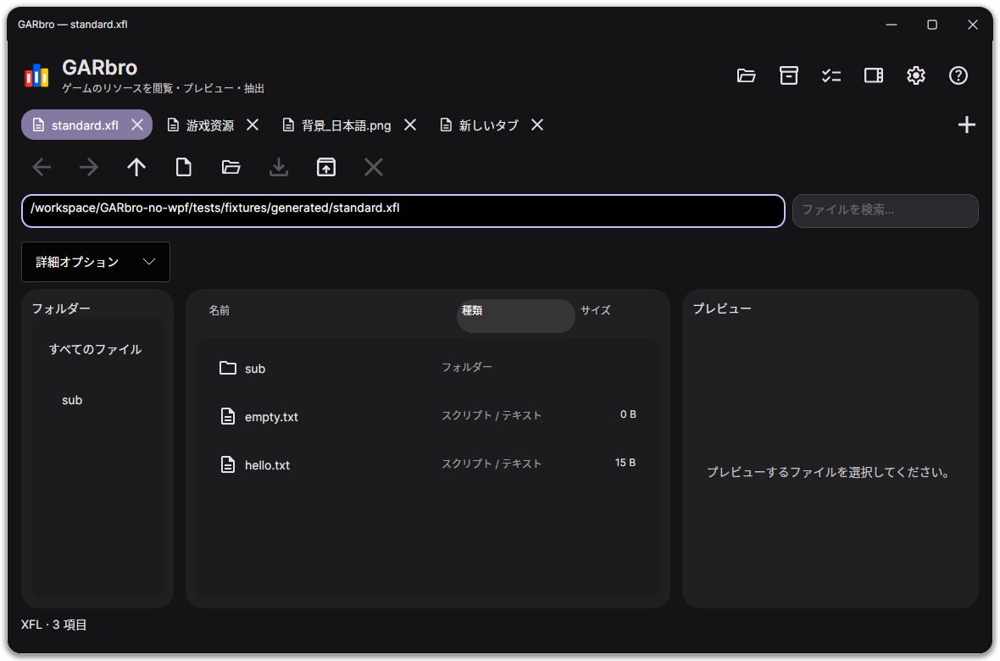

# GARbro-lazer

[简体中文](README.md) · [English](README.en.md) · [Русский](README.ru.md) · **日本語**

ゲームのリソースアーカイブを開き、画像・音声・動画を確認して、必要なファイルを取り出せます。ウィンドウで操作するほか、コマンドラインでも使えます。



## ダウンロードと起動

[リリースページ](https://github.com/Love-in-idleness/GARbro-lazer/releases/latest)で、システムと CPU に合ったファイルを選んでください。一般的な Intel・AMD の PC は **x64**、Windows on ARM、ARM Linux、Apple シリコンは **arm64** です。

GUI と CLI は同じ配布パッケージの `app` フォルダーを共有します。1.0.4 以前のパッケージでは、引き続き `desktop` と `cli` に分かれています。

| システム | ダウンロード | 起動方法 |
| --- | --- | --- |
| Windows | `win-x64.zip` または `win-arm64.zip` | 展開して `app/GARbro.Desktop.exe` を開く |
| Windows インストーラー | CPU に合った `.msix` と `.cer` | [手順](docs/install.md)に従って同じリリースの証明書を信頼し、MSIX をインストール |
| Debian 13 / Ubuntu 24.04 | CPU に合った `.deb` | インストール後、アプリ一覧から起動 |
| その他の Linux | `linux-x64.tar.gz` または `linux-arm64.tar.gz` | 展開して `app/GARbro.Desktop` を実行 |
| macOS 14 以降 | Apple シリコンは `osx-arm64.dmg`、Intel は `osx-x64.dmg` | GARbro フォルダー全体をローカルにコピーし、`GARbro.app` を開く |
| Flatpak | CPU に合った `.flatpak` | ソフトウェアセンターで開くか、`flatpak install --user ファイル名.flatpak` を実行 |

Flatpak と Store 版以外には、CPU に合った [.NET 10 Runtime](https://dotnet.microsoft.com/download/dotnet/10.0) が必要です。依存ライブラリーや証明書については[インストール手順](docs/install.md)をご覧ください。

一部のゲーム固有の暗号化や形式には対応していない場合があります。[Microsoft Store](https://apps.microsoft.com/detail/9NP39X1TRVNM) からもインストールできます。Flathub での公開は準備中です。Android の開発は保留中です。`store.msixupload` はストア提出用で、通常の利用には不要です。

## ウィンドウで使う

リソースは 1 つのウィンドウ内の別々のタブで開きます。再起動操作も既存のウィンドウへファイルを渡します。Ctrl/Cmd+T で新規タブ、Ctrl/Cmd+W で閉じる、Ctrl+Tab で切り替えます。設定からショートカットを変更できます。

1. ファイルやフォルダーをウィンドウにドラッグするか、右上の「ファイル」アイコンから開きます。アイコンにカーソルを置くと名前が表示されます。
2. フォルダーやアーカイブをダブルクリックして中に移動します。「戻る」「進む」「上の階層へ」で戻れます。
3. ファイルを選ぶとプレビューできます。音声と動画は「再生」を押したときだけ再生します。
4. 必要なファイルを選んで **F4** を押すか、「リソース処理 → すべて抽出」を選びます。出力先や変換、既存ファイルの扱いを指定して開始してください。

子フォルダーや子アーカイブも抽出するには、抽出ダイアログで再帰を有効にします。アーカイブ作成と一括変換は「ファイル」メニューにあります。子アーカイブや元のメディア形式を残さない設定は、成功した出力先のコピーだけを削除し、ゲームの元ファイルは保持します。

「プレビューの文字コード / HEX」で **HEX（16 進数）** を選ぶと、どのファイルでも生のバイト列をページ単位で確認・コピーできます。これは現在のプレビューだけの設定です。名前が文字化けするときは「設定 → デコード」で Shift-JIS などを選んでください。

表示言語は日本語、ロシア語、英語、簡体中国語に対応します。テーマや出力先も設定できます。「キーボードショートカット」では、コマンドを検索して実際にキーを押して登録・変更できます。競合があれば保存前に表示されます。1 つのコマンドに複数の組み合わせを指定でき、割り当て解除や既定値への復元もできます。

| 既定のキー | 操作 |
| --- | --- |
| Ctrl+O / Ctrl+P | ファイルを開く / 設定 |
| Enter / Backspace | 選択項目を開く / 上の階層へ |
| Alt+← / Alt+→ | 戻る / 進む |
| Ctrl+A | すべて選択 |
| F3 / F4 / F6 | アーカイブ作成 / 選択項目の抽出 / 変換 |
| F5 / Esc | 更新 / 処理のキャンセル |

macOS は Ctrl の代わりに Command を使います。テキスト編集と日本語入力の操作が優先されます。

DEB、MSIX、Flatpak、macOS アプリをインストールすると、対応するアーカイブの「別のアプリで開く」に GARbro が表示されます。既定にするかどうかはシステムで選べます。ZIP/TAR のポータブル版は自動登録しません。

## コマンドラインで使う

ダウンロードしたパッケージの `app` フォルダーでターミナルを開きます。PowerShell では `./garbro` を `.\garbro.exe` に置き換えてください。

```sh
./garbro --language ja-JP help
./garbro list "data.xp3" --scheme none
./garbro extract "data.xp3" --scheme none -o "output"
./garbro extract "game-data" --recursive --nested --encoding shift_jis -o "output"
./garbro convert "image.tlg" -o "image.png"

# 透明度を保持する可逆 WebP に変換
./garbro convert "image.png" -o "image.webp"

# 音声を FLAC、動画を MP4 に変換
./garbro convert "voice.ogg" -o "voice.flac"
./garbro convert "movie.mpg" -o "movie.mp4"

# 抽出時の変換・出力コピー削除オプションを表示
./garbro extract --help
```

`--scheme none` は暗号化されていない XP3 用です。暗号化されたリソースには適切な `--scheme` や `--options` が必要です。`--overwrite skip` は既存の出力をスキップし、`--overwrite replace` は置換します。スクリプト向けの結果には `--json` を使用できます。`--language` はコマンドの前後どちらにも指定できます。

## 困ったとき

「ヘルプ」の使い方とトラブルシューティングをご確認ください。解決しない場合は [Issues](https://github.com/Love-in-idleness/GARbro-lazer/issues/new/choose) にゲーム名、ファイル形式、システム、操作手順を記載してください。「ログをエクスポート」で診断情報を保存できます。パスワードやキー、共有する権利のないゲームデータは公開しないでください。

[詳しい使い方](docs/manual.ja-JP.md) · [インストール](docs/install.md) · [対応状況と制限](docs/compatibility.md)

[morkt の GARbro](https://github.com/morkt/GARbro) と [crskycode の保守版](https://github.com/crskycode/GARbro) を基にした [MIT ライセンス](LICENSE)のプロジェクトです。原作者、翻訳者、貢献者に感謝します。[サードパーティーのライセンス](docs/third-party.md)もご確認ください。
