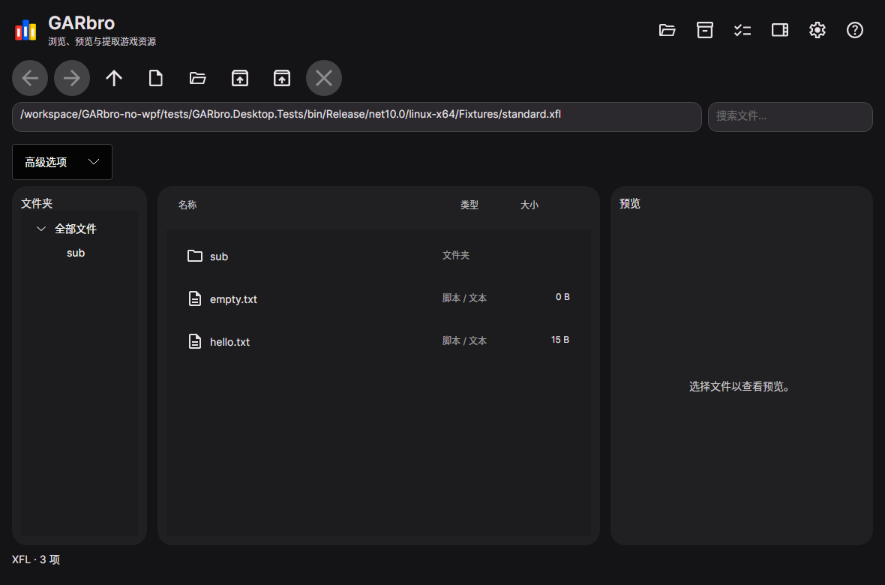

# GARbro

**简体中文** · [English](README.en.md) · [Русский](README.ru.md)

打开游戏资源包，看看里面的图片、听听音频，再把需要的文件提取出来。GARbro 提供图形界面，也可以在命令行中使用。



## 下载与启动

到 [预发行版下载页](https://github.com/Love-in-idleness/GARbro-no-wpf/releases/tag/v0.3.0-preview.1) 选择与你的系统和处理器对应的文件。普通 Intel、AMD 电脑选 **x64**；Windows on ARM、ARM Linux 和 Apple 芯片选 **arm64**。

| 系统 | 下载哪个 | 怎么打开 |
| --- | --- | --- |
| Windows | `win-x64.zip` 或 `win-arm64.zip` | 解压后打开 `desktop/GARbro.Desktop.exe` |
| Windows 安装版 | 对应架构的 `.msix` 和 `.cer` | 按[安装说明](docs/install.md)信任测试证书，再安装 MSIX |
| Debian 13 / Ubuntu 24.04 | 对应架构的 `.deb` | 安装后从应用菜单打开 GARbro |
| 其他 Linux | `linux-x64.tar.gz` 或 `linux-arm64.tar.gz` | 解压后运行 `desktop/GARbro.Desktop` |
| Apple 芯片的 macOS | `osx-arm64.tar.gz` | 解压后打开 `GARbro.app` |

这些桌面下载包需要先安装对应架构的 [.NET 10 Runtime](https://dotnet.microsoft.com/download/dotnet/10.0)。缺少依赖或遇到证书提示时，请看[安装说明](docs/install.md)。文件名中的版本号会随更新改变。

目前是预览版，部分游戏的资源可能打不开。Flathub 和微软商店尚未上架，Android 开发暂缓。`store.msixupload` 是商店提交文件，普通用户无需下载。

## 图形界面怎么用

1. **打开资源。** 将文件或目录拖进窗口，或在右上角“文件”图标菜单中选择打开文件、打开目录。悬停在图标上可以看到菜单名称。
2. **进入资源包。** 双击目录或识别出的归档，就像打开普通文件夹一样。用“视图”中的后退、前进、上一级返回其他位置。
3. **预览文件。** 选中图片、文本或音频查看预览。音频需要手动点击播放，不会自动出声。
4. **提取文件。** 选中需要的文件，按 **F4**，或在“处理”菜单中选择“全部提取”。选择输出目录，确认是否转换图片、音频，以及如何处理已有文件，然后开始。

需要连子目录、子归档一起展开时，选择**处理 → 递归解包**。创建归档和批量媒体转换也在“处理”菜单中。

文件名或文本乱码时，打开**设置 → 解码**，尝试 GBK、Shift-JIS 或其他编码。语言、深浅主题、默认输出目录也在设置中。若提示需要密码或游戏方案，请填写与该游戏对应的参数；并非所有加密方式都受支持。

| 快捷键 | 操作 |
| --- | --- |
| Ctrl+O | 打开文件 |
| Enter / Backspace | 打开所选项目 / 上一级 |
| Alt+← / Alt+→ | 后退 / 前进 |
| Ctrl+A | 全选 |
| F3 / F4 / F6 | 创建归档 / 提取所选 / 媒体转换 |
| F5 / Esc | 刷新 / 取消当前任务 |

macOS 可使用 Command 代替表中的 Ctrl。更多操作见[使用说明](docs/manual.zh-CN.md)。

## 命令行怎么用

CLI 在下载包的 `cli` 目录中。在这个目录打开终端即可运行。下面使用 Linux / macOS 的写法；Windows PowerShell 请把 `./garbro` 换成 `.\garbro.exe`。路径中有空格时保留引号。

```sh
# 查看帮助
./garbro help

# 看看未加密 XP3 资源包里有什么
./garbro list "data.xp3" --scheme none

# 提取到 output 目录
./garbro extract "data.xp3" --scheme none -o "output"

# 处理整个目录，并展开里面的子归档
./garbro extract "game-data" --recursive --nested --scheme none -o "output"

# 将支持的图像转换为 PNG
./garbro convert "image.tlg" -o "image.png"
```

`--scheme none` 表示不使用加密方案，适用于未加密的 XP3；加密资源需要指定自己的 `--scheme` 或 `--options` 参数。文件名乱码可加 `--encoding gbk` 或 `--encoding shift_jis`。已有输出默认会报冲突；加 `--overwrite skip` 可跳过，`--overwrite replace` 可替换。脚本处理结果时可加 `--json`。

## 遇到问题

先在“帮助”中查看使用说明和故障排查。仍无法处理时，请到 [Issues](https://github.com/Love-in-idleness/GARbro-no-wpf/issues/new/choose) 描述游戏名称、文件格式、系统和操作步骤；可通过“帮助 → 日志导出”附上诊断信息。不要公开密码、密钥或无权分享的游戏文件。

[安装说明](docs/install.md) · [已知兼容性限制](docs/compatibility.md) · [开发与构建](docs/migration-status.md)

本项目基于 [morkt 的 GARbro](https://github.com/morkt/GARbro) 及 [crskycode 的维护版本](https://github.com/crskycode/GARbro)，采用 [MIT 许可证](LICENSE)。感谢原作者、历代翻译者和贡献者；第三方组件的许可见[相关声明](docs/third-party.md)。
