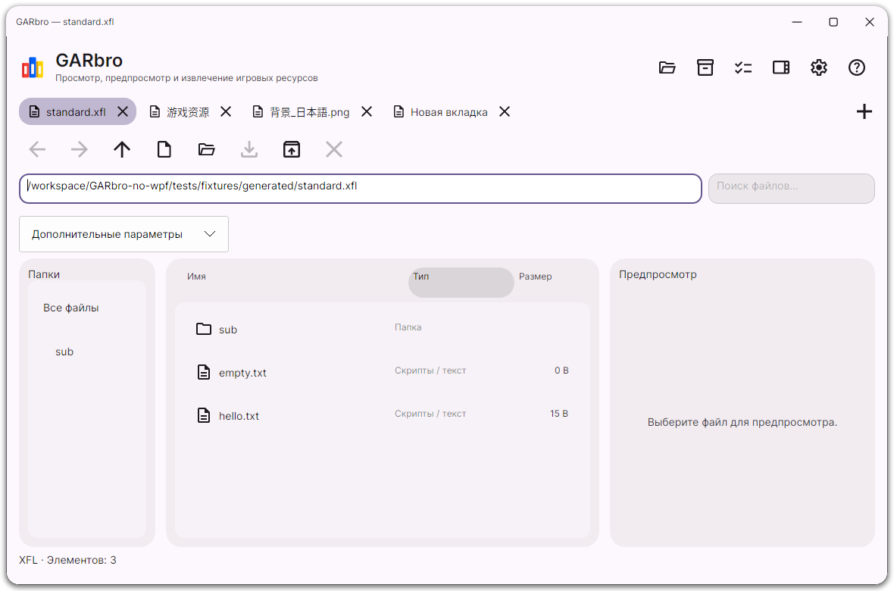

# GARbro-lazer

[简体中文](README.md) · [English](README.en.md) · **Русский** · [日本語](README.ja.md)

Открывайте архивы игровых ресурсов, просматривайте изображения, слушайте аудио и извлекайте нужные файлы. GARbro можно использовать как обычное приложение или из командной строки.



## Скачать и запустить

Выберите пакет на [странице выпуска](https://github.com/Love-in-idleness/GARbro-lazer/releases/latest). Для большинства компьютеров Intel и AMD нужен **x64**, для Windows on ARM, Linux на ARM и компьютеров Apple Silicon — **arm64**.

Теперь интерфейс и CLI находятся в одной папке `app` и загружаются вместе. В пакетах версии 1.0.4 и ниже остаются отдельные папки `desktop` и `cli`.

| Система | Какой пакет выбрать | Как запустить |
| --- | --- | --- |
| Windows | `win-x64.zip` или `win-arm64.zip` | Распакуйте и откройте `app/GARbro.Desktop.exe` |
| Установщик Windows | `.msix` и `.cer` для вашей архитектуры | Добавьте тестовый сертификат по [инструкции](docs/install.md), затем установите MSIX |
| Debian 13 / Ubuntu 24.04 | `.deb` для вашей архитектуры | Установите пакет и откройте GARbro из меню приложений |
| Другие дистрибутивы Linux | `linux-x64.tar.gz` или `linux-arm64.tar.gz` | Распакуйте и запустите `app/GARbro.Desktop` |
| macOS 14 или новее | `osx-arm64.dmg` для Apple Silicon, `osx-x64.dmg` для Intel | Откройте образ, скопируйте всю папку GARbro на компьютер и запустите `GARbro.app` |
| Flatpak | Файл `.flatpak` для вашей архитектуры | Откройте в центре приложений или выполните `flatpak install --user имя-файла.flatpak` |

Для настольных пакетов, кроме Flatpak и Store, нужен [.NET 10 Runtime](https://dotnet.microsoft.com/download/dotnet/10.0) соответствующей архитектуры. Если не хватает библиотек или появляется запрос сертификата, см. [инструкцию по установке](docs/install.md). В имени файла также указан номер версии.

Это стабильный настольный выпуск. Некоторые особые форматы и способы шифрования игр пока могут не поддерживаться. GARbro также доступен в [Microsoft Store](https://apps.microsoft.com/detail/9NP39X1TRVNM). Публикация во Flathub ещё готовится. Разработка Android приостановлена. Файл `store.msixupload` предназначен для отправки в магазин; для обычного использования он не нужен. Интерфейс и CLI доступны на русском, японском, английском и упрощённом китайском языках.

## Как пользоваться приложением

Ресурсы открываются во вкладках одного окна; повторный запуск передаёт файлы в него. Ctrl/Cmd+T создаёт вкладку, Ctrl/Cmd+W закрывает её, Ctrl+Tab переключает вкладки. Сочетания можно изменить в настройках.

1. **Откройте ресурсы.** Перетащите файлы или папку в окно либо выберите их в меню **Файл** справа вверху. Название меню появляется при наведении на значок.
2. **Войдите в архив.** Дважды щёлкните по папке или распознанному архиву. Для переходов используйте **Назад**, **Вперёд** и **На уровень выше** в меню **Вид**.
3. **Посмотрите содержимое.** Выберите изображение, текстовый, звуковой или видеофайл для предпросмотра. Воспроизведение начинается только по нажатию **Воспроизвести**.
4. **Извлеките файлы.** Выделите нужные файлы и нажмите **F4** либо выберите **Извлечь всё** в меню **Обработка ресурсов**. Укажите папку назначения, параметры преобразования и действия с уже существующими файлами, затем начните извлечение.

Для обработки вложенных папок и архивов включите рекурсию в диалоге извлечения. Создание архивов и пакетное преобразование находятся в меню **Файл**.

При рекурсивной распаковке можно не сохранять копии вложенных архивов, а при конвертации — исходный формат в выходной папке. Очистка выполняется после успешного завершения; исходные игровые файлы сохраняются.

В списке **Preview encoding / HEX** можно выбрать кодировку текста или посмотреть байты любого файла в режиме **HEX**. Доступны страницы и копирование. Выбор действует только для текущего файла и не меняет кодировку имён. Во время загрузки можно искать, отменять операцию и открывать другой ресурс.

Если имена файлов или текст отображаются неправильно, попробуйте GBK, Shift-JIS или другую кодировку в **Настройки → Декодирование**. В настройках также можно выбрать язык, светлую или тёмную тему и папку вывода по умолчанию. Если программа запрашивает пароль или схему игры, укажите подходящие параметры. Поддерживаются не все способы шифрования.

| Сочетание клавиш | Действие |
| --- | --- |
| Ctrl+O | Открыть файл |
| Enter / Backspace | Открыть выбранный элемент / на уровень выше |
| Alt+← / Alt+→ | Назад / вперёд |
| Ctrl+A | Выделить всё |
| F3 / F4 / F6 | Создать архив / извлечь выбранное / преобразовать медиафайлы |
| F5 / Esc | Обновить / отменить текущую задачу |

В macOS вместо Ctrl можно использовать Command. Дополнительные сведения есть в [руководстве](docs/manual.ru-RU.md).

## Командная строка

Утилита находится в папке `app` внутри скачанного пакета. Откройте терминал в этой папке. Примеры ниже написаны для Linux/macOS; в Windows PowerShell замените `./garbro` на `.\garbro.exe`. Пути с пробелами заключайте в кавычки.

```sh
# Показать справку
./garbro --language ru-RU help

# Посмотреть содержимое незашифрованного XP3
./garbro list "data.xp3" --scheme none

# Извлечь файлы в папку output
./garbro extract "data.xp3" --scheme none -o "output"

# Обработать папку вместе с вложенными архивами
./garbro extract "game-data" --recursive --nested --scheme none -o "output"

# Преобразовать поддерживаемое изображение в PNG
./garbro convert "image.tlg" -o "image.png"

# WebP без потерь с сохранением прозрачности
./garbro convert "image.png" -o "image.webp"

# Аудио в FLAC и видео в MP4
./garbro convert "voice.ogg" -o "voice.flac"
./garbro convert "movie.mpg" -o "movie.mp4"

# Параметры извлечения, преобразования и очистки выходных копий
./garbro extract --help
```

Параметр `--scheme none` отключает схему шифрования и подходит для незашифрованных XP3. Для зашифрованных ресурсов нужны подходящие `--scheme` или `--options`. При неправильных именах файлов добавьте `--encoding gbk` или `--encoding shift_jis`. По умолчанию существующие выходные файлы вызывают ошибку конфликта: `--overwrite skip` пропускает их, а `--overwrite replace` заменяет. Для обработки результатов в скрипте добавьте `--json`.

## Если возникла проблема

Сначала откройте руководство и страницу устранения неполадок в меню **Help**. Если это не помогло, [создайте обращение](https://github.com/Love-in-idleness/GARbro-lazer/issues/new/choose): укажите игру, формат файла, операционную систему и последовательность действий. Через **Help → Export logs** можно сохранить диагностический отчёт и приложить его к обращению. Не публикуйте пароли, ключи и игровые файлы, которыми вы не вправе делиться.

[Установка](docs/install.md) · [Известные ограничения](docs/compatibility.md) · [Разработка и сборка](docs/migration-status.md)

Проект основан на [GARbro от morkt](https://github.com/morkt/GARbro) и [версии, поддерживаемой crskycode](https://github.com/crskycode/GARbro), и распространяется по [лицензии MIT](LICENSE). Спасибо автору, переводчикам и участникам проекта. Лицензии сторонних компонентов приведены в [уведомлениях](docs/third-party.md).

В **Настройки → Сочетания клавиш** можно найти команду, записать и добавить сочетание, удалить привязку или восстановить значения по умолчанию. У команды может быть несколько сочетаний; конфликты показываются до сохранения.

Установленные DEB, MSIX, Flatpak и приложение macOS добавляют GARbro в список «Открыть с помощью», сохраняя текущие приложения по умолчанию. ZIP/TAR не регистрируют ассоциации.
