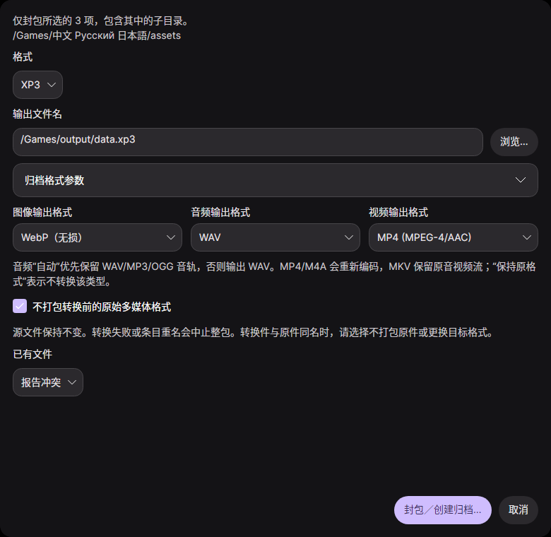
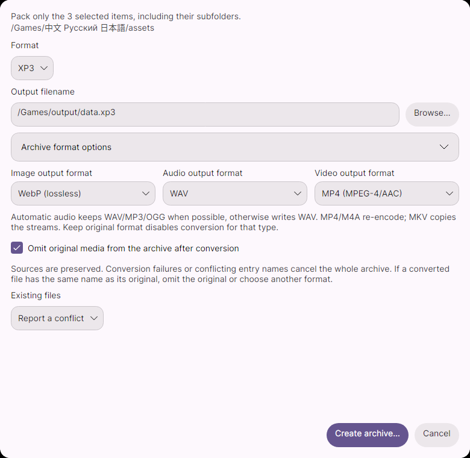

# 1.1.1 封包开发记录

本轮先发布 [1.1.0 正式版](https://github.com/Love-in-idleness/GARbro-lazer/releases/tag/v1.1.0)，再提交 1.1.1 开发代码。1.1.1 尚未创建标签或 Release。

1.1.0 全平台发布构建：[Release 43614856565](https://github.com/Love-in-idleness/GARbro-lazer/actions/runs/43614856565)，源码 `ad40aa7f8c1cc601ef3cecda196e3ed152446685`。公开 Linux x64 DEB 已下载核对，45,401,232 字节，SHA-256 为 `633027092e1d9e71ac525429de6d5527888872c42acfa5a1cf959d8bcc538a46`。商店上传文件及 Flatpak 均已提供，未代替维护者向 Partner Center 或 Flathub 提交。

## 使用

在文件菜单、右键菜单或 F3 打开封包窗口。选择可写归档格式、输出文件和格式参数。选中时只封包所选内容，未选中时使用当前目录；目录包含子目录。

图像、音频和视频转换均为可选，默认保持原格式。开启转换后默认保留原件；勾选“不打包转换前的原始多媒体格式”则仅将转换件写入归档，其他文件照常入包。源文件不会被删除或替换。

```sh
garbro create assets -o data.xfl
garbro create assets -o data.zip --image-format webp --audio-format wav --discard-original-media
garbro create assets -o data.xp3 --format XP3 --scheme none
garbro create image.png voice.mp3 -o selected.zip --json
```

单目录以目录内容为根；多输入保留共同父目录下的相对路径。格式无法从扩展名唯一确定时，必须指定标签或完整格式标识。`--options` 是归档写入参数，独立于转换用的解码配置。脚本回编译属于格式转换，本轮没有新增回编译工具。

## 事务与兼容

- 原 `resource-create` 和 `CreateArchive` 入口保留，委托给共用服务；新增 `resource-pack` 返回结构化结果。
- `ArchivePackingOptions` 传递三个媒体目标格式及原件保留规则；`ArchivePackingResult` 报告输出、格式、写入／跳过状态、条目数、转换数和归档大小。
- 转换先写临时目录，整包成功后才原子替换输出。转换失败、条目重名、取消或超限均保留原包，并清理临时文件。
- 目录重叠输入去重，跳过目录内已有输出包，拒绝通过链接读写。音频 AUTO 直通只入包一次。重名不自动改名；同扩展名转换需要排除原件或更换格式。
- 输入公共根和可移植条目名规则由 F# 实现。收集、转换和写包的进度按阶段报告，并限制通知频率，避免大量文件淹没界面队列。

## 验证

1.1.0 发布前的 17 项脚本编码、Fate 封装和 METEOR01 回归通过；随包 Wayland 哈希、四语言资源和发布配置检查通过。Wayland 独立重建的已知哈希差异继续明确保留。

1.1.1 的 8 项封包回归通过，其中复用一个测试验证现有 22 个可写后端创建与回读。新增检查覆盖图像／音频／视频转换、原件保留与排除、实际回读媒体、源文件不变、AUTO 直通、重名、损坏媒体、取消和限额。窗口选择快照和格式选项的两项定向界面检查通过。

`tools/smoke-create.py` 检查真实 CLI 的四语言帮助、媒体转换、JSON、多输入、跳过、限额和输出排除。四语言、深浅主题共八张封包窗口由共享 Avalonia/Skia 界面实际渲染，检查操作按钮在窗口内；未为 1.1.1 重跑全部平台测试。macOS 仅在 1.1.0 发布时构建安装包，没有运行测试。





转换后的媒体能否被游戏直接读取取决于引擎支持；不会自动改写游戏脚本中的资源引用。
