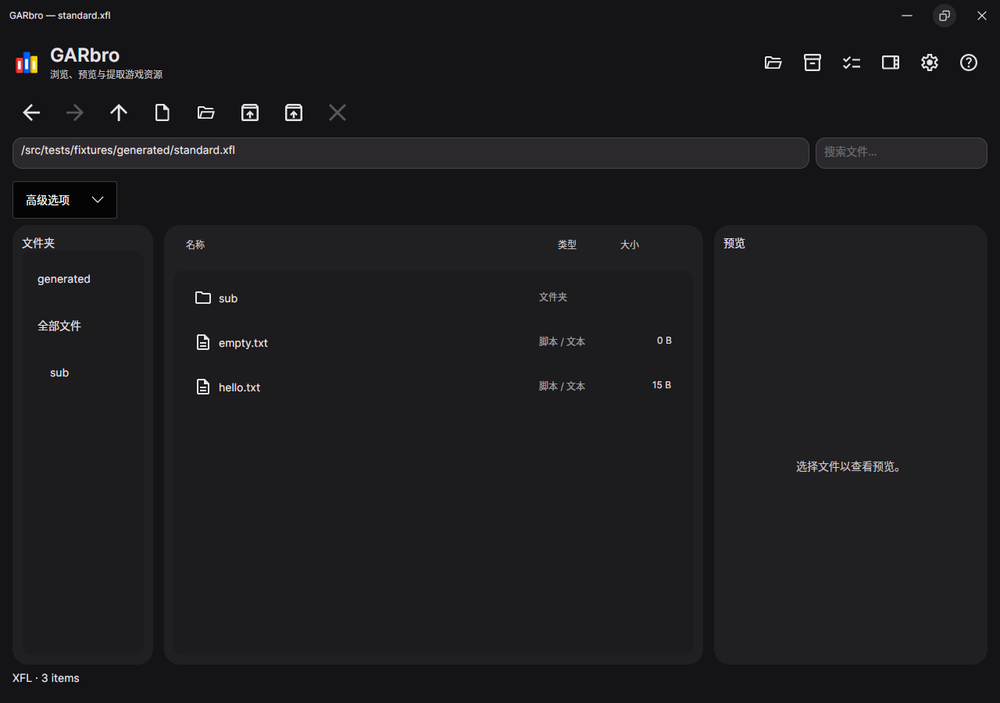
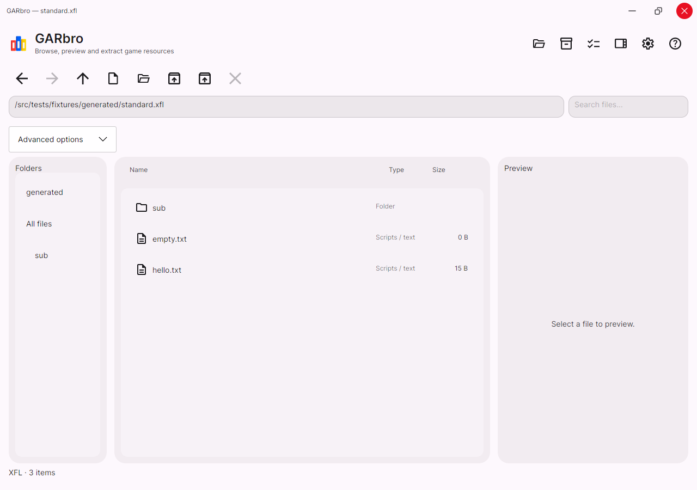
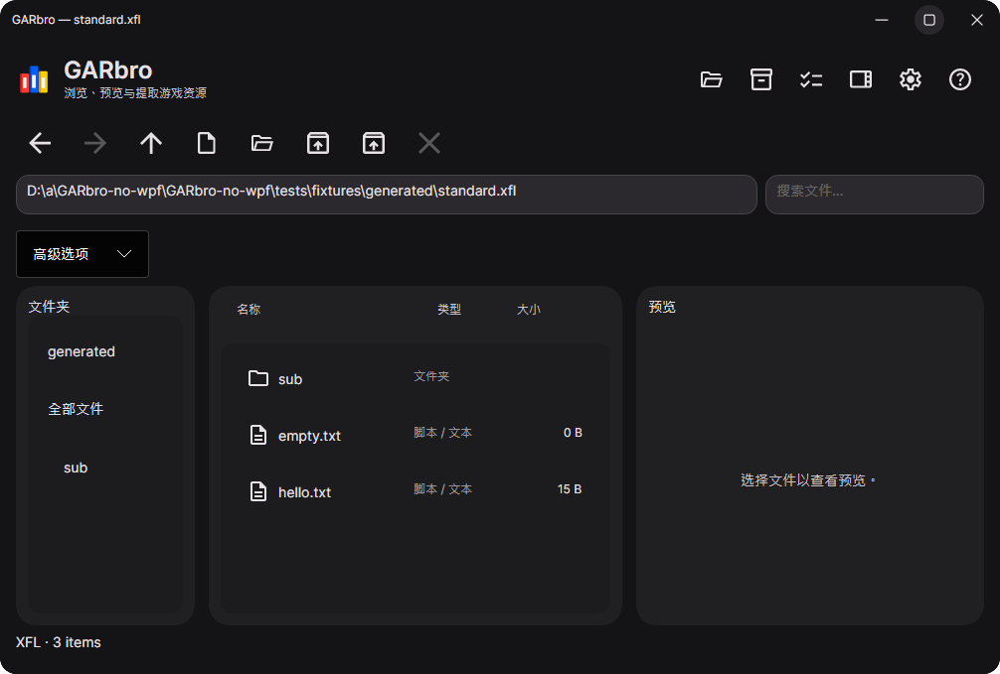
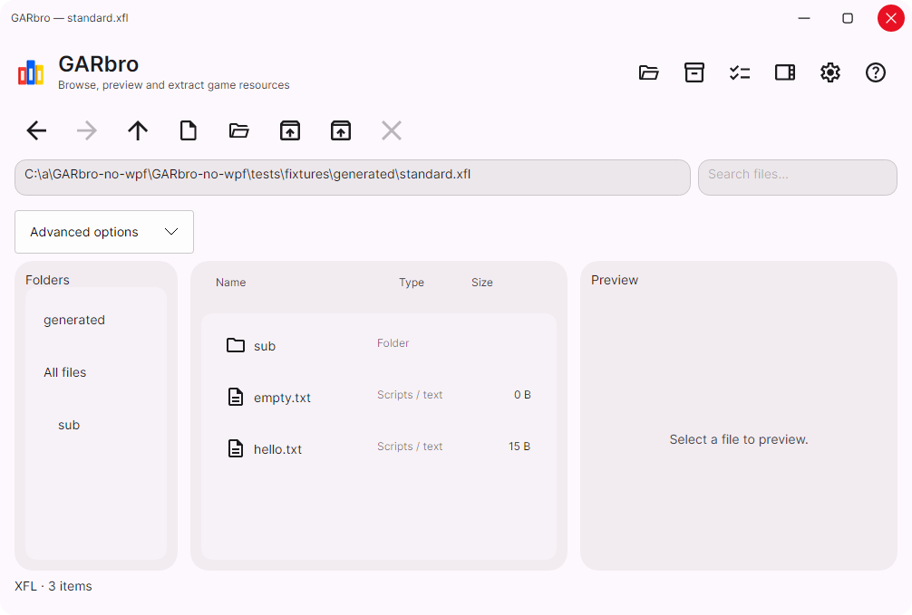

# Caption buttons and system cursors

This is a code-only follow-up to 1.0.2. No release, tag, published package or
application version was changed. Windows and Linux retain one shared caption
template; application menus remain below its 40-DIP title bar.

本轮只提交修复与验证材料，不发布新版本，也不替换已发布的 1.0.2。
Windows 与 Linux 共用标题栏；三个按钮的点击区域仍为 46×40，状态背景为 32×32 圆形。

The backend source and exact hashes are pinned in
[manifest.json](../../../tools/patches/avalonia-wayland/manifest.json).
Only Avalonia.Wayland uses `12.1.4-garbro.1`; other Avalonia dependencies remain
12.1.4. Its assembly identity is unchanged, including version `12.1.4.0` and
public key token `c8d484a7012f9a8b`. The independent
[reproduction/API check](https://github.com/Love-in-idleness/GARbro-no-wpf/actions/runs/41683152821)
passed with SDK 10.0.403 and 60 public/protected API records.

| Check | Evidence |
| --- | --- |
| Caption rendering | Eight Skia pixel cases: light/dark at 100%, 125%, 150%, 200%. Idle, hover, pressed, disabled and keyboard focus; corners remain transparent. |
| Desktop regression | 54 tests passed locally, including actual indexer-binding language changes. Existing icon buttons retain their icons when language changes. |
| Localization and packaging helpers | 230 bilingual resource keys and offline documents; 22 Python tests passed, including old dependency dates in Windows ZIPs. |
| KDE 6.3.6, Debian 13 x64 | Installed test DEB; the installed backend DLL SHA-256 matches the checked-in package. Actual nested output and native cursor screenshots; popup and settings-dialog pointer enters. |
| Live KDE cursor settings | Client deliberately requests Breeze Light at size 8. KWin's Breeze 24 → 48 changes visible arrow bounds from 14×22 to 31×45; switching KWin to Breeze Light changes its pixels. No client cursor surface is sent on the standard-shape path. See [kde6.json](kde6.json). |
| Protocol absent | KWin 5.27.11 on Ubuntu 24.04: standard cursors use system libwayland-cursor. Separate `XCURSOR_SIZE=24` and `48` runs produce different visible bounds. See [24](kde5-fallback-24.json) and [48](kde5-fallback-48.json). |
| Native Wayland text input | Sway 1.10.1/wlroots 0.18.2: CJK preedit, commit, UTF-8 surrounding deletion and focus transfer passed with the final backend. Maximize/minimize protocol requests also passed. |
| X11 | Real Openbox/Xvfb window: maximize, restore, minimize, close and extraction passed; continuous video still produced 22 distinct native pixel regions. |
| Clean offline restore | Linux x64 and ARM64 restored from a single local feed into empty package caches, including the local patched backend. This local check used runtime packs 10.0.13; the Flatpak matrix uses its pinned 10.0.14 packs. |
| Windows x64 / ARM64 | Both native backends captured light/dark, English/Chinese hover states and passed caption actions. The x64 matrix completed. ARM64 also passed application tests and native video; its ZIP timestamp error is fixed with a regression test. |
| Flatpak x64 / ARM64 | Both complete offline builds, sandbox startup and Flathub validation [passed](https://github.com/Love-in-idleness/GARbro-no-wpf/actions/runs/41685587647). |
| Cross-platform matrix | Full test results, installer checks and KDE traces are retained in [PR checks](https://github.com/Love-in-idleness/GARbro-no-wpf/pull/1/checks). Ubuntu 26.04's newer Wayland header requires the test helper to link libm; this is now explicit. |

KDE 6 protocol captures cover Arrow, Ibeam, Hand, Wait, AppStarting, both axial
resize cursors, DragCopy/DragMove/DragLink and hidden/visible protocol transitions.
These are standard cursor requests from a test-only driver, not a GARbro cursor
factory. No cursor assets, theme selection or additional Flatpak theme-file
permissions were added. DEB declares `libwayland-cursor0` for the fallback.

The live tests use private, nested KWin sessions and existing distribution
themes. On hosts without a DRM render node, the screenshots come from the
actual nested X output and its XFixes cursor image. This exercises native
Wayland clients, not XWayland. Hardware DPI changes, physical multi-seat/device
hotplug, compositor reconnect and interactive drag/snap still need manual
hardware acceptance; per-pointer lifetime and enter-serial handling were
reviewed in the source patch. Fullscreen popover controls reuse the same circle
theme; their live overlay presentation is not included in these captures.









Reproduce the source build and pixel checks:

```sh
python3 tools/build-patched-wayland.py --verify
python3 -m unittest discover -s tools/tests
python3 tools/check-ui-localization.py
dotnet test tests/GARbro.Desktop.Tests -c Release
```

See [Linux desktop instructions](../../linux-desktop.md) for private KDE and
Wayland protocol tests. The local package's byte-for-byte hash check disables
ambient GARbro source-link revision data; LF attributes preserve source hashes
in Windows checkouts. Offline Flatpak builds copy the verified local package
from the pinned source tree into their offline NuGet feed.
