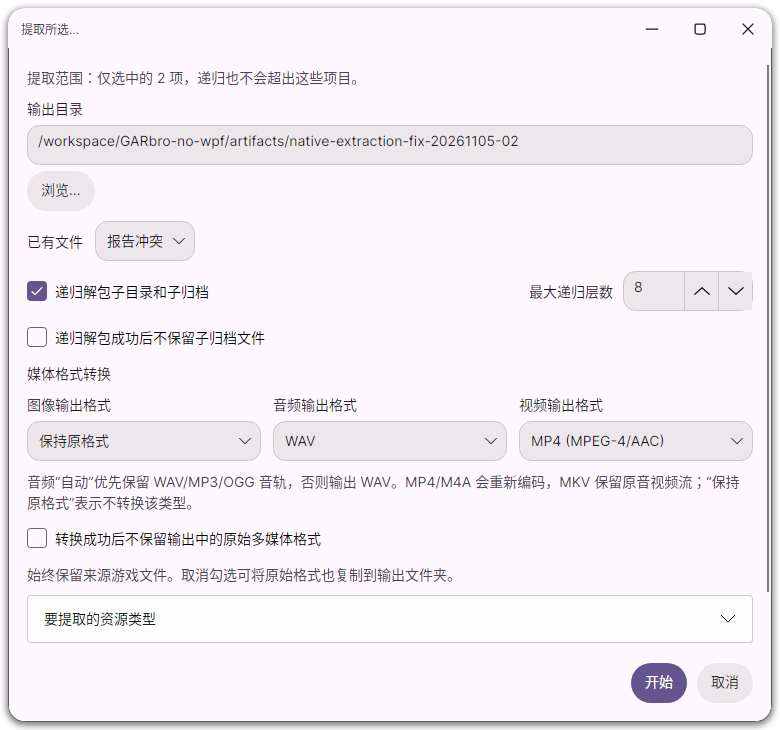
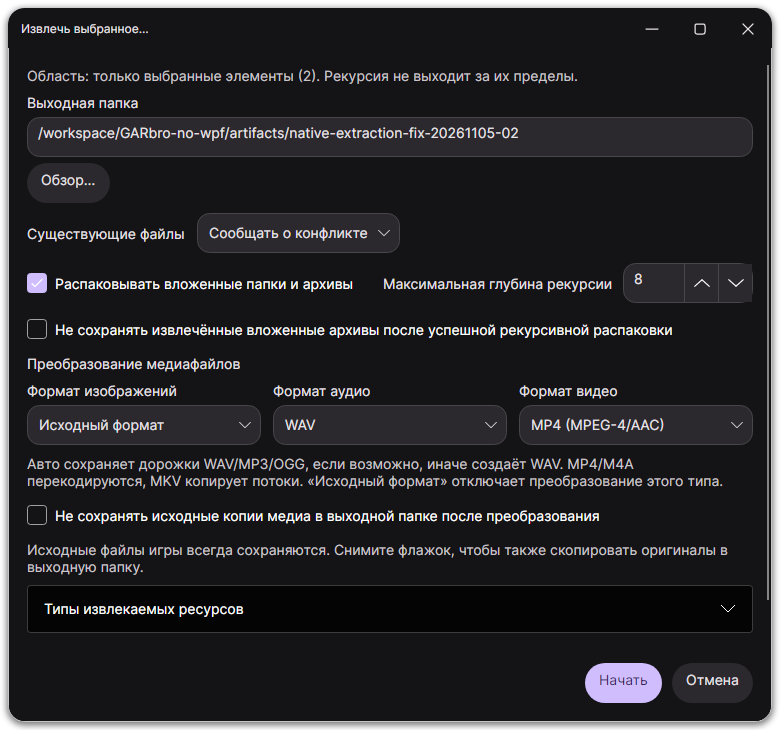

# Extraction scope and media output regression

The extraction menu has two commands: **Extract selected** and **Extract all**.
Recursion is a checkbox in either command's dialog. Selection and the current
archive subdirectory are captured before the dialog opens; recursion cannot
widen that scope. Changing the browsed resource dismisses the pending request.

The same dialog now exposes separate image, audio and video formats. Audio
supports automatic common-format output, WAV, FLAC and M4A; video supports MP4
(MPEG-4/AAC) and MKV stream copying. “Keep original format” copies that type without
conversion. Source documents are never removed. Discarding originals only applies
to successfully produced output copies; failed conversions retain the raw copy
and show per-file errors.

## Local verification (2026-11-05)

| Check | Result |
| --- | --- |
| Full core suite with the pinned FFmpeg 8.0 recipe | 170 passed |
| Final focused extraction suite, including output-copy conflicts | 18 passed |
| Desktop suite, including modal selection changes and media choices | 70 passed |
| CLI smoke checks | Passed |
| Python packaging/tool tests | 24 passed |
| Four-language key and placeholder checks | 432 matching keys per language |
| Native Linux X11 window, fixture listing and extraction | Passed |
| Continuous native video rendering | 22 distinct captured frame regions |
| Extraction dialogs: EN/ZH/RU/JA, light/dark | Eight native screenshots reviewed |

The new worker tests verify two selected XFLs without touching sibling archives,
current archive-subdirectory boundaries, nested quotas/retries, raw-copy retention
after conversion failure, source-file preservation, output collisions, forced
binary extraction, and mixed-media batch conversion. Output tests decode the
generated WAV/FLAC/M4A and probe MP4/MKV duration and stream metadata. The native
FFmpeg profile was rebuilt with the new codec list, not substituted by the host's
more permissive FFmpeg installation.

Linux screenshots below use the real Avalonia X11 backend, Xvfb and Openbox.
They do not establish physical audio-device, KDE desktop or cross-platform
installer acceptance. The normal portable CI matrix reruns worker/desktop tests
and installer checks on Windows, Linux and macOS, for x64 and ARM64. These fixes
do not change the published v1.0.3 assets.

