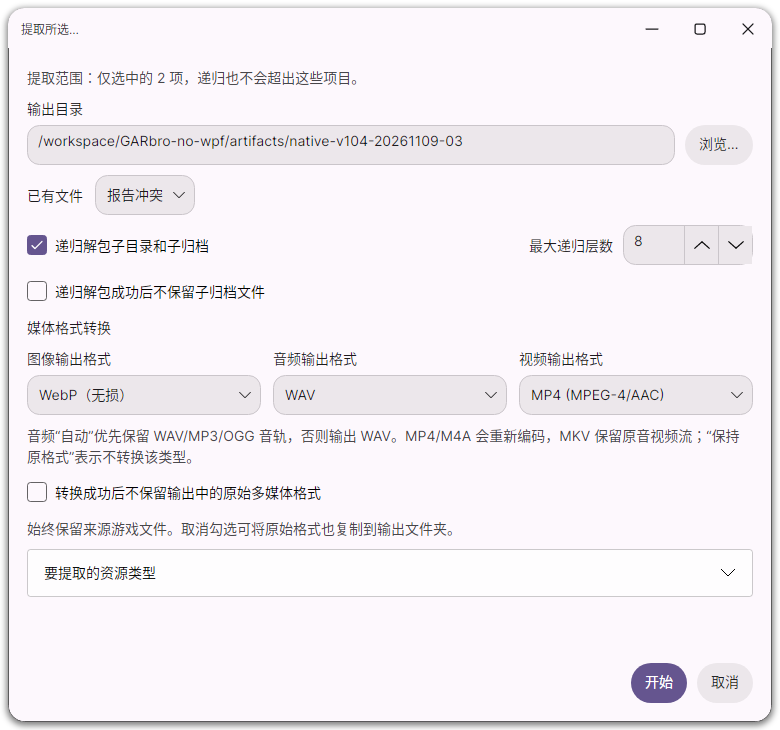
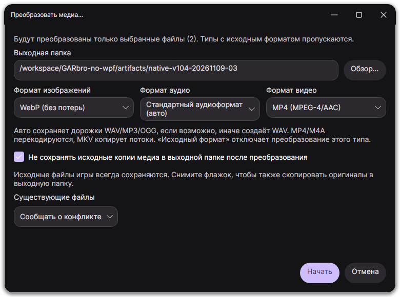
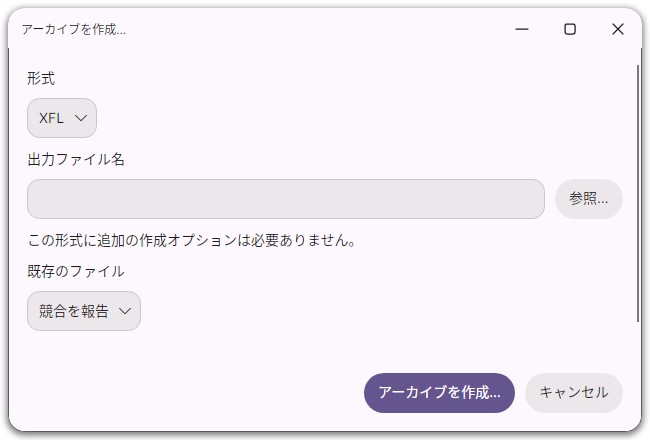

# 1.0.4 local regression record

Verified on 2026-11-09 with .NET 10, Linux x64 and a real Avalonia X11 window in
Xvfb/Openbox. These results do not replace native platform and installer checks;
the completed application regressions also passed on Windows/Linux x64 and ARM64
and macOS x64 before the release workflow was simplified. Per maintainer request,
macOS now builds packages only, without runtime tests; release builds do not
repeat full suites already passed for unchanged application code.

| Check | Result |
| --- | --- |
| Core suite | 185 passed |
| Desktop suite | 73 passed |
| CLI command/JSON/exit-code smoke tests | Passed |
| Python packaging/tool tests | 24 passed |
| Four-language resource keys, placeholders and offline documents | 457 matching keys |
| Native listing, extraction and caption actions | Passed |
| Actual continuously rendered video | 24 distinct captured frame regions |
| EN/ZH/RU/JA desktop, shortcuts, extraction, conversion and creation | 40 native screenshots |

The WebP tests compare exact BGRA pixels, including transparency and hidden RGB,
for 1×1, 3×2 and 17×9 images; they also exercise the portable raster encoder,
worker extraction and unchanged source files. The CLI checks cover real
WebP/FLAC/MP4 output, four-language command help, global options, dash-prefixed
filenames, rejection of unsupported/conflicting options, directory scans with
repeated archive names, source-file protection and shared output budgets.

GUI regressions create and read back an XFL after changing selection in the
dialog, with deliberately unrelated reader parameters present. They also check
mutual exclusion of data-operation dialogs, selected extraction, independent
media formats and separate converted/skipped/failed counts. An additional regression
checks startup, empty-directory and zero-result selection, followed by selecting
all visible rows after restoring the filter; selection ranges are explicitly bounded. The final screenshots
use inline path pickers and a full-width preview encoding selector, after
correcting Russian text clipping found in the native images.

